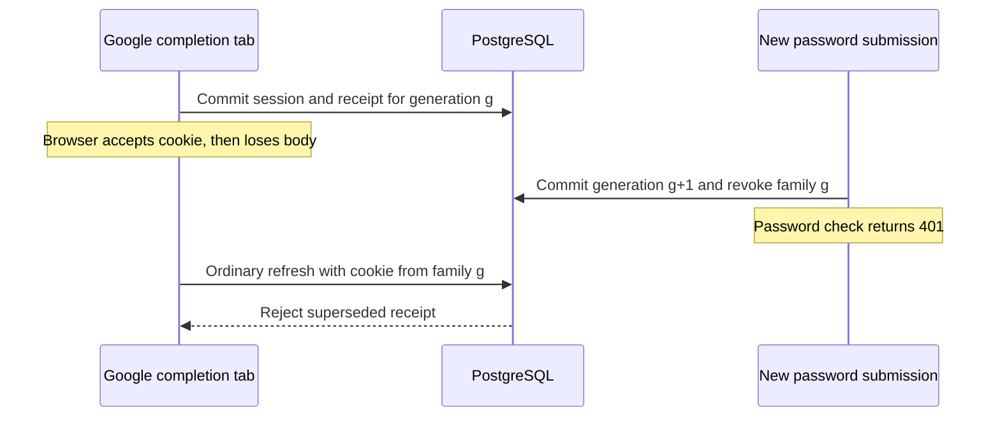

# M01B-R1 server-side authentication intent fencing

**Status:** Proposed for approval. **Scope:** Architecture and implementation plan. **Reviewed base:** `2f7df3efce4c46217d155657b3bf7dc0fe0c6ff9` with the stopped M01B working-tree patch.

## 1. Verified failure and source

In B27, Chromium accepted the active refresh cookie from a Google activation response and the connection then lost its body. In B28, Chromium accepted the same kind of cookie and the initiating tab closed before observing the body. In each test a newer, deliberately invalid password submission returned 401. Ordinary refresh returned 200, `GET /api/v1/me` returned the older Google account, and PostgreSQL retained one unrevoked, unreplaced session for that Google subject. A successful newer password switch with a delivered activation body was covered separately by B26. B25 revoked the older family with the delivered bearer but surfaced a failed sign-out confirmation. These are findings from the prior disposable HTTPS run. [M01B verification, sections G–J](../verification/M01B-google-react-handoff.md#h-race-condition-verification)

The current completion client checks local intent before dispatch and before publishing. Its compensating logout requires the access bearer in the activation body. Cookies can be applied before that body is read. Web Locks coordinate cooperating scripts, and a tab can release its lock on destruction. Neither the client marker nor the lock changes what the ordinary refresh endpoint accepts. The failed password handler has no committed record of its intent, so it has no way to find and revoke the Google family. [Client](../../frontend/src/shared/api/client.js#L302) · [Password and refresh routes](../../backend-js/src/modules/auth/routes.js#L32) · [Google activation](../../backend-js/src/modules/auth/googleHandoff.js#L100)

### Source inventory

The index was empty. Tracked working-tree modifications were:

- Backend configuration and wiring: `backend-js/.env.example`, `backend-js/src/app.js`, `backend-js/src/core/config.js`.
- Backend auth and tests: `backend-js/src/modules/auth/google.js`, `backend-js/src/modules/auth/routes.js`, `backend-js/src/modules/auth/service.js`, `backend-js/tests/google.test.js`.
- Frontend: `frontend/.env.example`, `frontend/src/app/App.jsx`, `frontend/src/features/auth/AuthMethodNav.jsx`, `frontend/src/features/auth/GoogleLoginPage.jsx`, `frontend/src/features/auth/authApi.js`, `frontend/src/shared/api/client.js`.

Pre-existing untracked files were `backend-js/src/modules/auth/googleHandoff.js`, `backend-js/tests/google-handoff-config.test.js`, `docs/architecture/M01B-google-react-handoff-specification.md`, `docs/verification/M01B-google-react-handoff.md`, `frontend/src/features/auth/GoogleCompletionPage.jsx`, `frontend/src/features/auth/GoogleHandoff.test.jsx` and `frontend/src/shared/api/googleSession.test.js`.

The PostgreSQL migration chain is `0_baseline` → `20260928_phase12_organization_invitations` → `20260929_phase14_roadmap_lifecycle` → `20260929_phase15_cohort_governance` → `20261008_phase18_activity_deadlines` → `20261009_activity_plans` → `20261108_roadmap_review`. The baseline defines the UUID session ID and family ID, a unique refresh hash, indexed family/user/expiry, a unique replacement link with a self-FK, and the user FK with delete cascade. Rotation marks the source revoked and replaced and inserts a successor with the same family ID. The schema has no independent family or browser-intent entity. OAuth identity is unique on provider and subject. Tenant access derives from account status and organization membership after authentication. [Prisma schema](../../backend-js/prisma/schema.prisma#L14) · [Baseline SQL](../../backend-js/prisma/migrations/0_baseline/migration.sql) · [Tenant authorization](../../backend-js/src/core/authorization.js) · [ADR-003](../decisions/ADR-003-authentication-model.md)

## 2. Invariant and recommended design

**After a valid same-browser intent commits, no ADR-003 session issued for a superseded Google attempt in that browser context can pass a subsequent authentication decision or rotate into a usable descendant.** For a protected request the decision point is the primary-database eligibility read. A request authorized before the newer commit may finish. A response emitted after that commit can still contain an older bearer or refresh cookie, which the server must reject. The invariant applies without waiting for a credential check, a response, or client compensation.

An intent is authoritative at the commit that increments the locked browser context generation and fences its older Google receipt. Concurrent requests can reach that boundary in a different order from the user's clicks. Valid means an explicit supported action, expected request shape, exact first-party Origin, proof of a live server-issued context, and rate-limit admission. A syntactically valid wrong password, unknown login identifier, or incorrect/expired six-digit OTP still advances. A malformed request, cross-origin request, background refresh, unbound legacy request or retry of an already accepted UUID cannot advance that context. An offline click takes effect only once a request reaches the server and commits.

Use two additive tables for a browser context and its intent records. A Google intent becomes the authoritative receipt for exactly one session family. A nullable link on existing session rows identifies fenced Google families. Keep the current per-user lock to serialize refresh with exact-family revocation. Check the receipt and original browser proof on every fenced refresh and bearer authorization. Password and phone families continue to use existing ADR-003 semantics. This approach leaves old-cookie overwrite as a recoverable loss of access in the browser, with the newer family still intact.

## 3. Browser binding and request boundary

- Issue `__Host-outpost_auth_context` from `POST /api/v1/auth/browser-context`. Use 32 bytes from the server CSPRNG, base64url encoded, `Secure`, `HttpOnly`, `SameSite=Strict`, `Path=/` and no Domain. Persist only its SHA-256 digest as 32-byte `bytea`. It conveys authority to fence its own Google intents and is also the second proof for its fenced Google sessions. It carries no account or role. No IP, User-Agent or fingerprint participates in validation. [Cookie prefixes, SameSite and response processing](https://datatracker.ietf.org/doc/html/draft-ietf-httpbis-rfc6265bis)
- Bootstrap uses exact configured Origin, `Content-Type: application/json`, an empty JSON object and `X-Acadboost-Browser-Auth: 1`. Return 200 `{ "context_id": "<uuid>" }` with no-store. For a valid binding, return the same public selector and emit no Set-Cookie. When enabled, a missing, expired or invalid binding can be replaced only through this endpoint with a fresh independent context. Never transfer attempts or families or reissue an existing proof. Reject duplicate binding cookies before lookup.
- The proposed maximum binding lifetime is **90 days from creation**, with no sliding renewal and no regular rotation of a live proof. The server deadline is authoritative even if the browser retains the cookie longer. Bound Google refresh expiry is `min(now + existing 30 days, context.expires_at)`. Set the fenced refresh cookie's Max-Age to the remaining session lifetime, rounded down. Bearer eligibility checks that deadline and the underlying session expiry. On expiry or cookie eviction, a Google user must authenticate again. Other login methods and their existing lifetimes are unaffected.
- Under the existing browser lock, React waits for bootstrap, then submits `POST /api/v1/auth/google/intent` with JSON `{ "context_id": "<uuid>", "attempt": "<uuid>" }` and the same marker header. The server compares the public context ID with the actual cookie-bound row. A mismatch or absent cookie fails closed. On 204, React records only the public attempt UUID and UI expiry in its existing storage and navigates to the approved authorize path. If two cold bootstraps are sent despite the lock, both server-issued cookies are distinct. A late bootstrap may disrupt a subsequent step. An older context's Google bearer and refresh require that older proof, and subsequent bootstraps never reissue it. The context echo protects the interval between bootstrap and intent. Cookie validation protects authorize, activation and session use. Test both header orders.
- Strict proof is used for first-party authorize, activation and authenticated API calls. The cross-site top-level Google callback continues to use the independent, callback-scoped M01A Lax correlation cookie. It need not receive the Strict proof. The stored M01A state carries the context ID, intent ID, public attempt and generation from the server. Those fields supplement the proof-bound state, nonce, PKCE verifier, fixed issuer and atomic consume. The callback never sets or renews the context or standard refresh cookie. [M01A report](../verification/M01A-google-oauth-browser-binding.md) · [Approved M01B flow](M01B-google-react-handoff-specification.md)

The canonical HTTPS origin comes from `OUTPOST_PUBLIC_APP_ORIGIN`, with the same exact origin and API path contract as M01B. The approved ingress serves a single host, rejects unexpected hosts and strips untrusted forwarding headers. Compare request Origin byte-for-byte to configured origin. Reject missing, `null`, multiple and foreign origins on guarded mutation requests. A site under the same registrable domain can still be a different origin. Keep CORS closed to foreign credentialed requests. For guarded mutations, Fetch Metadata can reject an explicit cross-site signal as defense in depth. Origin and binding proof remain required. Reject duplicate guarded cookies or intent headers. Existing malformed JSON handling runs before intent mutation. Request logs use route and request ID only for auth diagnostics, with cookie, Authorization, query, body, proof/digest and provider tokens excluded at application and ingress.

The navigation GET that claims a Google intent additionally requires browser-controlled `Sec-Fetch-Site: same-origin`. Origin is often absent on a navigation GET, and a same-site sibling can cause a browser to send a Strict cookie. The authorize GET rejects missing metadata, user-typed navigation and sibling-origin navigation. The same-origin availability probe verifies Fetch Metadata support before showing Google. The cross-site provider callback is exempt and continues to validate M01A correlation. This extra compatibility constraint applies only to Google. [Fetch Metadata request headers](https://www.w3.org/TR/fetch-metadata/)

Rate-limit bootstrap at the approved ingress using its verified client address, and cap new bound intents per context by counting recent accepted rows under the context lock. Proposed starting bounds are 10 bootstraps per minute per address and 30 accepted attempts per minute per context. Use the existing OTP challenge, resend and attempt limits in addition. Rate rejection precedes advancement. Return the existing structured 429 and generic response. Bootstrap/Google start require the Google gate. Enforcement for already bound sessions and browser intents remains active when the Google flag is off. Keep canonical origin configured through the drain period. If it is absent, fail closed on bound mutations and Google session use.

## 4. Intent lifecycle and idempotency

1. Context generation starts at zero. PostgreSQL owns a signed `BIGINT`, incremented under its row lock. Use JavaScript `BigInt` in the server and decimal strings in Valkey. Do not expose an authoritative generation field to the client or compare a Lua floating-point conversion. At `9223372036854775807`, fail closed and retire the context at its deadline. Never wrap or reuse an ID. At the proposed rate cap the upper bound is unreachable within a context lifetime.
2. Scope a client-generated v4 action UUID to the context. Each explicit submission gets a new UUID. Retry of that UUID returns an idempotent result or a conflict and never advances again or replays a credential operation. Keep accepted IDs until the context retires. Do not persist a password or OTP hash merely to compare duplicate input.
3. Google start can repeat the 204 only for the still-current, live, unclaimed intent of the same kind. An old, expired, already claimed or differently typed action ID returns 409. On initial Google start, reject a usable current standard session with 409 `session_conflict` before advancing. A previously issued Google family whose cookie is absent or unusable can be fenced by a deliberate new Google start.
4. The existing Google authorize GET validates binding, selected intent and generation and claims that intent once before building the M01A redirect. The attempt must be live for up to 12 minutes from acceptance. The M01A state keeps its 600-second maximum and the pending handoff keeps its 120-second maximum. Bound both server-side TTLs by remaining intent lifetime. The pending cookie's configured Max-Age remains 120 seconds. A failed authorize after claiming requires a new action.
5. Callback performs the M01A compare/consume before provider exchange. It checks that the server intent is still current before exchange, verifies Google as today and prepares a grant only if the intent still looks live. These are read checks. The final authority is the activation transaction. The grant contains intent/context IDs, server generation, attempt selector, verified principal and absolute grant expiry, keyed by a separate proof digest. Wrong browser, wrong selector, malformed or expired grant must leave unrelated state intact.
6. Valid password login and phone verify requests reserve and claim the action in the advancement transaction before verifying credentials. A duplicate credential request returns 409 `auth_intent_already_submitted` without replaying Argon2, consuming an OTP, issuing a cookie or re-advancing. A new explicit submit uses a fresh UUID. Unaccepted or rejected actions leave no durable receipt. A credential submission that loses precedence before session issuance returns 409 `auth_intent_superseded` without setting a cookie.
7. Explicit current or all-session logout records its action and outcome in the same transaction as fencing. Repeat of the same completed logout returns 204 without another Set-Cookie. Repeat of a denied logout returns the original generic error and never re-advances. An explicit new request after recovery uses a fresh UUID. A background restore, refresh, registration without login, OTP send/resend, password reset, route render, callback, session list or targeted session deletion does not advance the context.

## 5. Proposed storage and receipt contract

Schema names below are the proposed Prisma models and mapped PostgreSQL identifiers. They describe the migration for the next task.

| Prisma model | PostgreSQL table | Fields and SQL types |
| --- | --- | --- |
| `AuthBrowserContext` | `auth_browser_contexts` | `id uuid` PK, generated UUID. `binding_digest bytea` nullable for retirement, unique. `generation bigint NOT NULL DEFAULT 0`. `created_at timestamptz(6)`, `expires_at timestamptz(6)` required. `retired_at timestamptz(6)` nullable. |
| `AuthBrowserIntent` | `auth_browser_intents` | `id uuid` PK, generated UUID. `context_id uuid` required FK to context. `action_id uuid` required. `kind varchar(24)` required. `generation bigint`, `accepted_at timestamptz(6)`, `redeem_until timestamptz(6)` required. `claimed_at timestamptz(6)` nullable. `logout_outcome varchar(16)` nullable. `token_family_id uuid`, `session_user_id uuid`, `activated_at timestamptz(6)`, `superseded_at timestamptz(6)` nullable. |
| Existing `AuthSession` | `auth_sessions` | Add only `browser_intent_id uuid NULL` and its optional Prisma relation. Legacy rows retain NULL. Existing `token_family_id` and `user_id` supply the other composite relation scalars. |

- Context constraints require nonnegative generation and `expires_at > created_at`. A live row requires an explicitly non-NULL 32-byte digest. A retired row has a retirement timestamp and a NULL digest. Use explicit NULL predicates in SQL CHECK expressions so an unknown result cannot admit a half-populated tuple. Index `expires_at`.
- Intent constraints require positive generation, `redeem_until > accepted_at`, and allowed kinds `google`, `password`, `phone`, `logout`, `logout_all`. The claim timestamp, when present, is between acceptance and redemption expiry. A non-Google intent is claimed at acceptance and all four receipt fields must be NULL. A Google intent can be unclaimed or claimed with all four receipt fields NULL. An issued Google intent must have a claim timestamp and all of family ID, user ID and activation time, with activation at or after claim and before redemption expiry. The fourth field, supersession time, remains NULL until fencing and then is at or after activation. A stale unissued attempt is detected by generation. `logout_outcome` is NULL outside logout kinds and is `completed` or `denied` for committed logout rows.
- Define unique `(context_id, action_id)`, `(context_id, generation)`, `token_family_id` (nullable), and `(id, token_family_id, session_user_id)` for the composite FK. Index `(context_id, accepted_at)` for rate limiting and `auth_sessions(browser_intent_id)` for lookup and FK checks. Existing `auth_sessions(token_family_id)` supports exact-family update. The context-first unique keys cover context lookup and cleanup. Validate the proposed Prisma relation with the repo version and inspect emitted PostgreSQL constraints. [Prisma compound keys and indexes](https://www.prisma.io/docs/orm/prisma-schema/data-model/indexes)
- The context FK uses `ON DELETE RESTRICT ON UPDATE RESTRICT`. The session FK is `(browser_intent_id, token_family_id, user_id)` → `(id, token_family_id, session_user_id)`, with `MATCH SIMPLE` and `ON DELETE RESTRICT ON UPDATE RESTRICT`. A NULL intent ID leaves legacy rows valid. A linked row must match both family and user. The receipt's `session_user_id` is a historical UUID, with no separate user FK. The existing user-to-session cascade can remove sessions and leave a receipt until retention cleanup. No cascading change is added to accounts or tenant data.
- Receipt states are accepted/claimed before issuance, active when the family is assigned and its generation is current, and superseded when that receipt is fenced. The family tuple is assigned once and the tombstone is irreversible in the service. The composite FK prevents reparenting a referenced tuple. Every rotation writer copies `browser_intent_id` from the predecessor. The FK permits legacy NULL, so propagation is a service invariant with a real-database test. Ordinary logout, account-wide revocation and replay continue to revoke session rows. The receipt's `superseded_at` specifically records browser intent supersession. Browser-context, receipt, user and session validity are checked together for a fenced row. There is no client endpoint to change receipt state or select a family.
- At expiry or authorized retirement, hold the context lock, erase the digest and retire the row. The access/refresh deadline makes the family inert immediately even before the cleanup runs. Non-receipt intent rows can be deleted after retirement and their replay window closes. Retain activated receipts while any session row references them. Delete unreferenced retired receipts and then the context in bounded batches. Initial rollout leaves existing session and audit retention alone. Receipt metadata can outlive the browser deadline when historical session rows are retained. A future retention policy can delete expired session rows only with separate data-retention approval. Do not detach an existing row from its receipt to force cleanup.

## 6. Transactions and lock order

Use PostgreSQL primary reads and short explicit `READ COMMITTED` transactions. Take locks before relying on mutable state, then reread in subsequent statements. Evaluate expiry with the database clock after acquiring the needed locks so lock wait time counts. Lock order for a path that uses all stages is **context → identity advisory or OTP challenge locks, as applicable → existing user rows in ascending UUID order → receipt/intent writes → session writes → security event**. Password verification and provider I/O run outside database locks. Phone verification keeps its existing challenge and phone-identity locking inside the credential transaction, after any context lock and before the user lock. Existing recovery paths take the user lock before touching sessions and never take a browser context lock. Keep Google subject → email advisory ordering when both are needed. Use disjoint advisory lock key namespaces for the two Google lock classes so a hash collision cannot invert them. Acquire neither identity nor challenge locks after a user row. [PostgreSQL 17 row locks and deadlocks](https://www.postgresql.org/docs/17/explicit-locking.html) · [PostgreSQL 17 transaction isolation](https://www.postgresql.org/docs/17/transaction-iso.html)

| Operation | Required transaction steps |
| --- | --- |
| Accept newer intent | Lock context by proof digest, confirm deadline and replay rules. Read current receipt and derive its user only from PostgreSQL. Take the user lock if a receipt or regular logout target exists. For two target users, lock both in UUID order. Revalidate any regular logout authority under lock before self-fencing its Google bearer. Increment generation, insert new intent, mark the old receipt superseded, and revoke all unrevoked rows matching receipt ID, family and user. Record sanitized event. Commit together. |
| Activate Google | Validate origin/shape/context and peek at valid Valkey grant without consuming it. Check the request's existing usable refresh cookie without rotating it. Return 409 and preserve the valid grant on conflict. Invalid or mismatched grant returns 401 before conflict. Then atomically consume the same grant via Lua and enter the PostgreSQL transaction. Lock context, revalidate live generation and exact claimed intent. Resolve Google by provider subject with existing advisory locking. Lock/re-read a linked user and check active status. Assign a new family to the receipt, insert first ADR-003 session linked to it, record the normal authentication event, and commit. Return the standard bearer/cookie only after successful commit. |
| Guarded password or phone issuance | The acceptance commit above precedes credential verification. Password KDF runs without holding locks. Before issuing, lock context and compare generation and deadline, then lock and reread the user. Confirm the verified credential version is still current after a concurrent password reset. For phone, take context before the existing OTP/challenge and identity locks, check current generation and finish OTP outcome plus successful session issuance atomically. Preserve attempt counting for invalid code by committing that outcome. The new password/phone family has a NULL receipt link. A credential failure leaves the earlier intent committed. |
| Rotate refresh | Initial hash lookup is a locator. Lock that row's user, then reread source, current account, receipt and context in fresh queries. Use a non-locking MVCC context read, even for a fenced family. Verify exact original binding and exact Origin for fenced ordinary refresh before replay processing. Reject stale, retired or superseded receipts before creating a descendant. Copy the same receipt ID when rotating. Preserve existing replay-family revocation and event for an otherwise eligible family whose source was already replaced. No context row lock is taken while holding user. |
| Current/targeted revocation, logout-all, recovery reset | Existing user lock serializes row revocation with refresh. Bound browser logout is the only variant that first locks context and advances intent. Existing password reset and targeted session revocation keep their user scope and do not acquire context after user. An explicitly revoked family cannot rotate using its revoked source. |
| Bearer, session listing, cookie conflict | For fenced access, make the auth decision in one primary query joining session, user, intent and context. Require ownership, active user, unrevoked/unreplaced and unexpired session, active receipt, current generation and exact unexpired original context proof. JWT format and verification remain unchanged. Use corresponding live eligibility in cookie conflict and session listing. Account-wide session management can list/revoke a different browser's eligible session without its binding if the requesting JWT is authorized. The other browser's proof is only required to authenticate with that session. |

Family mutations scope the update by family, user and the same optional intent link as the verified source. If a receipt's historical user has already been deleted, the existing user FK has removed its session rows. Commit the receipt tombstone even then, and omit any audit insert requiring a deleted session or user. Treat the context/receipt join as invalid if its required linkage is absent.

Use separate pure transaction helpers for row creation and response/signing, so Google can allocate the family ID and link the receipt before session insert without the current nested-transaction shim. Return IDs and hashed-row results internally, preserve the public access-token envelope and do not return family/receipt IDs. A Valkey consume and PostgreSQL commit cannot be atomic together. A consumed grant whose SQL work fails yields safe unavailable or invalid and requires a fresh Google intent. No session cookie is emitted on a transaction failure. If PostgreSQL commits but the response or signing fails, the receipt still exists and a subsequent bound intent fences it. Use bounded retries only for known transaction aborts before the response and before redoing any non-idempotent external operation. An unknown commit outcome must be resolved using the durable action ID or by requiring an explicit fresh action.

### Race proof

| Ordering | Consequence |
| --- | --- |
| Newer intent wins context lock and commits first | Activation rereads the changed generation under lock and issues no family. A grant validated or consumed earlier gives no authority. |
| Activation wins context lock and commits first | Newer intent finds its exact receipt, commits the marker and revokes all matching session rows. Credential success/failure and delivery of the activation bearer are immaterial. |
| Refresh wins the user lock before fencing | It sees the last committed receipt and may insert a linked successor. The newer intent takes the lock next, revokes that successor too and commits the durable fence. A delayed rotation response is rejected on its next use. |
| Fencing wins the user lock before refresh | Refresh rereads after the lock, sees supersession or row revocation and returns 401 without inserting a successor. |
| Two refreshes contend | Existing user lock serializes them. Replay of a valid family's replaced source revokes the family. If the receipt is already fenced, either source or descendant is rejected. |
| Google activation and suspension/deletion overlap | If suspension/deletion wins the user lock, activation observes inactive/missing and creates no session. If issuance wins, later committed inactive status rejects both access and refresh. A hard delete cascades session removal. An administrative workflow that can reactivate users must revoke sessions at suspension if its policy forbids reuse on reactivation. No user-status administration route was identified in the reviewed backend. Any authorized writer must participate in the user-row protocol. |
| B27 or B28 after new intent commits | The earlier active cookie can survive in Chromium. Ordinary refresh cannot use it because the receipt is fenced, and any issued access JWT fails the same live eligibility check. The result holds with a closed tab, no client compensation and a later ordinary refresh from another tab. |

The user lock already exists on rotation, exact-family revoke, revoke-all and password reset. An update of known rows without that common lock would leave a race with a newly inserted child. The receipt provides a durable check even if an extant linked row was missed. Readers never take a context lock after a user lock. Run barrier-controlled SQL cases for both orders rather than relying on test sleeps. [Session service](../../backend-js/src/modules/auth/service.js#L126) · [Password reset revocation](../../backend-js/src/modules/auth/recovery.js#L128)

## 7. Endpoint compatibility and client integration

Guarded password/phone and logout use `X-Acadboost-Auth-Intent: <v4 uuid>` on the existing routes. The upgraded same-origin frontend sends it once per deliberate action even if Google is disabled. If there is no context cookie, those endpoints retain their existing credential/bearer behavior and the header conveys no authority or state change. A present binding cookie requires a valid proof, exact Origin, correct header and existing body contract. Bound requests fail closed on missing/malformed header, invalid binding, stale context, rate limit or DB outage. This lets deployed unbound API clients continue using current payloads and responses. Roll the updated client before issuing contexts so cached old clients can recover by reloading. Requests with invalid/retired proof can recover through first-party bootstrap while Google is enabled, or let the expired browser cookie clear through normal expiry. If the feature is disabled during an invalid-proof recovery window, provide a same-origin reset response that can clear only an invalid/expired binding, with no adoption of an earlier family. Do not silently continue on that same failed mutation.

For guarded endpoints use the existing error envelope and request IDs. Deny foreign Origin with 403, missing or invalid proof with generic 401, and structurally invalid intent fields with 422. Preserve the application's existing malformed JSON response and M01B activation denial contract. Use 409 for intent conflicts and 503 for unavailable required dependencies. Callback failures always use the fixed M01B redirects.

| Request | Guarded browser behavior | Compatibility |
| --- | --- | --- |
| `GET /api/v1/auth/google/availability` | New, no-store 204 when backend Google configuration and dependencies are accepted and the probe carries `Sec-Fetch-Site: same-origin`, controlled 503 otherwise. No proof, session data, or credentials in body. | Frontend combines result with build flag and browser capabilities before showing Google as available. No effect on other sign-in methods. |
| `POST /api/v1/auth/browser-context` | New, first-party bootstrap described above. Only enabled bootstrap mints a cookie. JSON `{"reset":true}` with the same Origin/header returns 204 to clear an expired/invalid binding, including while issuance is off. Missing cookie yields 204 without clearing. A live binding yields 409 `auth_context_active`. | No adoption of older context. A valid context may be reused when feature is enabled. |
| `POST /api/v1/auth/google/intent` | New, strict proof and public context match. Returns no-store 204 or safe error. | Required before Google authorize in R1. Direct unbound request cannot create an attempt. |
| `GET /api/v1/auth/google/authorize?attempt=<uuid>` | Valid context, live unclaimed intent and `Sec-Fetch-Site: same-origin` required. 302 to configured Google after one-time claim. | Query selector and redirect path from M01B preserved. No arbitrary redirect target. |
| `GET /api/v1/auth/google/callback` | M01A correlation proof and state. Fixed 303 success or allowlisted cancellation, invalid or unavailable. | Strict context cookie is unnecessary on the provider return. No active session issuance. |
| `POST /api/v1/auth/refresh` with Google selector | M01B header, no body, exact Origin, current context and live grant. Standard bearer and active refresh on success. | Malformed guarded requests never fall through to ordinary refresh. Valid session conflict remains 409. |
| Ordinary `POST /api/v1/auth/refresh` | Fenced family additionally requires original context proof and exact Origin. No generation change. | Legacy password, phone and historical rows rotate as before. A stale Google cookie returns generic 401. |
| `POST /api/v1/auth/password/login`, `POST /api/v1/auth/phone/verify` | Valid guarded submission fences before checking credentials. Recheck generation at issuance. | Keep credential errors, OTP semantics, success envelope and standard cookie. Unbound requests keep legacy behavior. |
| `POST /api/v1/auth/phone/request`, registration and recovery | Existing workflows. OTP request and resend prepare a challenge. OTP verification is the explicit sign-in intent. | No new browser generation writes. Existing password-reset revocation remains effective. |
| `POST /api/v1/auth/logout` | Bound action fences its own Google receipt. A still-valid bearer at entry can also authorize ordinary logout of its exact family. Without a usable bearer, return 204 if no usable unrelated session is presented. If a usable unrelated refresh cookie is present, commit fencing and return 401 so the user can explicitly resume and sign out from that account. | No account identity comes from the binding. Never blindly restore and revoke whichever cookie arrived. Omit cookie clearing unless the incoming cookie belongs to the exact revoked family or verified logout scope. Legacy bearer logout retains its existing contract. |
| `POST /api/v1/auth/logout-all` | Advance and fence the context. Only a current, eligible bearer revalidated before fencing grants the existing account-wide action. If no such bearer, commit context fencing and return generic 401. | Valid ordinary and bound bearer paths preserve user scope and 204. Binding by itself never revokes all sessions of any account. |
| `GET /api/v1/me`, protected resources, session listing/targeted deletion | Fenced bearer requires the original binding plus live session. The middleware and tenant checks use the canonical user. | Password/phone and historical bearer semantics, JWT format, public response and role rules remain. |

For logout, decode a presented JWT before the transaction and revalidate its exact session under the user lock. Select any Google receipt exclusively from the validated context. Preserve scope even when the current bearer and fenced Google receipt belong to different users. If a late logout clear can erase a newer cookie, treat it as the same cookie-availability issue as a late activation response. The browser Web Lock still coordinates cookie-writing operations. An explicit action waiting for that lock becomes authoritative only once its request commits. The tests also send requests independently to prove the server guarantee without this coordination.

On B27/B28 recovery, use the existing accessible error and offer an explicit sign-in or current-context sign-out. Allow deliberate credential submissions while the uncertainty marker is present. Clear it on a confirmed new session or sign-out, and leave it in place on an uncertain outcome. The frontend may drop the existing exact-bearer compensation for supersession once the server fence is established. Preserve no automatic retry of a credential or Google activation. An uncertain Google flow with no newer intent may have committed a *current* Google session. An explicit newer sign-out or sign-in fences it. Ordinary refresh may restore a still-current eligible family if the user deliberately resumes it. React remains responsible for tab intent and route navigation, while the server owns authentication eligibility.

## 8. Cookie response ordering and alternatives

| Approach | Security and availability | Cost and decision |
| --- | --- | --- |
| Context generation and exact-family receipt | Revokes authority and descendants independent of response order. Delayed Google or rotation headers may overwrite the newer cookie. A newer bearer already in memory can work until it needs refresh. On reload, a rejected stale cookie may require explicit reauthentication. The newer family is still valid server-side. | **Recommended.** Two new tables and an optional link preserve one ADR-003 session system. Approve the reauthentication trade-off explicitly. |
| Add provisional activation acknowledgement | A response carrying only a provisional credential can limit the lost-first-body case. A final acknowledgement that sets the shared refresh cookie has the same late-header race and can also lose its response. Avoiding replacement in every ordering would require a different cookie selection or recovery protocol. | Extra state, endpoint, retries, cleanup and failure modes without a stronger authority guarantee. Revisit only if uninterrupted recovery is required. |
| Context generation and exact-family row revocation using only existing user lock | With every rotation obeying the existing user lock and all rows updated atomically, row revocation is sufficient for today's paths. It still needs an exact durable family association and a safe retention story. | Smaller read-path change, but no explicit marker at the family authorization boundary to catch a missed row. Reuse the lock and put the marker on the receipt rather than creating a global family table. |
| Client-only compensation or a Valkey-only epoch | Local storage/Web Locks cannot fence a bearer the client never receives. Valkey-only checking cannot atomically order PostgreSQL issuance and durable revocation. | Inadequate for B27/B28 and Redis/SQL failure ordering. |

If preserving the newer cookie across every header ordering becomes an acceptance requirement, approve a separate compatibility design before implementation. A stable browser handle or multiple cookie slots would change how ADR-003 selects refresh credentials. The R1 acceptance check must report both whether the stale credential is rejected and whether the browser can still reach the newer account. [Cookie replacement rules](https://datatracker.ietf.org/doc/html/draft-ietf-httpbis-rfc6265bis#name-storage-model)

## 9. Migration rehearsal, rollout and rollback

1. In the separately approved implementation, generate one additive Prisma migration after `20261108_roadmap_review`. Create context and intent tables, checks, indexes, unique keys and foreign keys. Add a nullable column without default or backfill to `auth_sessions`. Inspect DDL for constraint names, index builds and lock duration on a restored database. Use a maintenance window or staged validation if table size makes the FK/index lock material. Check the Prisma model and actual database catalog agree on the composite FK and delete action.
2. Restore a verified backup or approved sanitized copy into a disposable PostgreSQL 17 instance or separately guarded disposable database. Verify the target before writes. Rehearse the exact migration chain on a fresh disposable database as a second case. Compare schema, migration records, row counts and stable checksums or sampled relationships for users, sessions, OAuth identities, password and phone identities, organizations, memberships, roadmap versions, cohort pins, progress and audit history. Check legacy sessions keep NULL and retain auth behavior. Exercise invalid ownership linkage, user delete/cascade, old receipt delete rejection and cleanup order in disposable fixtures.
3. Deploy schema before compatible code, with Google start and activation flags off. Existing non-fenced data needs no migration rewrite. Before enabling the fenced flow, inventory any previously issued Google sessions without receipts using existing authentication events and validate rollout disposition. Legacy rows cannot be retrospectively bound to a browser by guessing. If any uncontrolled historical Google families exist, require separate approval to invalidate the relevant families before including them in a release guarantee.
4. Roll forward with mixed-version protection. During rollout no server running old session enforcement may serve fenced issuance or authenticate fenced credentials. Disabling Google stops issuance and leaves fencing in force. Application rollback to a build without fenced reads requires draining or revoking all issued fenced families using the current enforcement, expiring pending grants and preventing stale instances from serving them. Dropping the nullable link would erase a security association and is unsafe with extant rows. Keep additive schema in place during rollback. Restore from backup only as an explicitly approved recovery operation with its own loss analysis.

## 10. Implementation work and ownership

The following paths and steps are for the separately approved implementation. The approved R1 code should remain reviewable together with the original M01B patch.

| Step | Files | Work and verification gate |
| --- | --- | --- |
| R1.1 Reproduce and anchor | New `backend-js/tests/db/browser-auth-intent.test.js`, `frontend/tests/e2e/google-handoff.spec.mjs`, `frontend/tests/e2e/google-handoff-fixture.mjs`, and updates to `frontend/package.json` and `frontend/package-lock.json` | Add deterministic red tests for intent-before-activation, activation-before-failed-login, rotate-vs-fence, B27 and B28. Register an opt-in `test:e2e:google` script with a pinned test-only `playwright-core` dependency and explicitly supplied fixture browser executable. Build a disposable TLS fixture with separate PostgreSQL, Valkey and browser identities. Assert actual DB state. |
| R1.2 Schema and transactions | `backend-js/prisma/schema.prisma`, new `backend-js/prisma/migrations/<timestamp>_m01b_r1_browser_auth_intents/migration.sql`, new `backend-js/src/modules/auth/browserIntents.js`, `backend-js/src/modules/auth/service.js` | Add models, exact FK and lock helpers. Implement locked advancement, durable receipt, rotation propagation, common authorization eligibility and cleanup helper. Add constraint, existing auth and race checks, then rehearse on restored disposable copy. |
| R1.3 HTTP and OAuth | `backend-js/src/app.js`, `backend-js/src/core/config.js`, `backend-js/.env.example`, `backend-js/src/modules/auth/google.js`, `backend-js/src/modules/auth/googleHandoff.js`, `backend-js/src/modules/auth/routes.js`, `backend-js/src/modules/auth/phone.js` | Add bootstrap and intent contracts, Origin guards, rate limits and disablement. Carry context through M01A/Valkey and finish activation and bound password/phone/logout paths. Restore M01A suite in `backend-js/tests/google.test.js` and extend `backend-js/tests/google-handoff-config.test.js`, `auth-flow.test.js`, `phone.test.js`, and `request-errors.test.js` in the same test directory. Review `backend-js/src/modules/auth/recovery.js` for lock compatibility. Existing recovery behavior can stay in place if proven by `backend-js/tests/recovery.test.js`. |
| R1.4 Shared client and UI | `frontend/src/shared/api/client.js`, `frontend/src/features/auth/authApi.js`, `frontend/src/features/auth/AuthMethodNav.jsx`, `frontend/src/features/auth/GoogleLoginPage.jsx`, `frontend/src/features/auth/GoogleCompletionPage.jsx`, `frontend/src/shared/api/googleSession.test.js`, `frontend/src/features/auth/GoogleHandoff.test.jsx` | Gate CTA on backend capability, bootstrap and register only explicit actions, preserve Web Lock and error/focus handling, and remove dependence on compensation. Extend existing shared session and auth journey suites as needed for contract regressions. |
| R1.5 Acceptance | Browser fixture files above and `docs/verification/M01B-google-react-handoff.md` | Execute the matrix below, regress the full backend and frontend, check lint/build/syntax, preserve sanitized evidence and report initial/final counts and exit codes. Independently review security and migration rehearsal before an implementation commit. |

Use test-driven development for each slice. Run the relevant failing test first and confirm it fails for the expected security behavior, then apply the minimal change and rerun targeted tests. Follow with the clean full suites on the integrated patch. The authorization module, account roles, tenant schemas and identity-linking features require coverage and review, with no planned product changes.

Use a GPT-6.1 Sol High lead for the integrated contract and final security decision. The two read-only investigations for this specification used native GPT-6 Luna Medium agents. For implementation, assign one agent the database/concurrency slice and another the HTTP/browser contracts once interfaces are frozen. Have the lead own `service.js` and `client.js` boundaries or explicitly assign each file to one owner. Run an independent security review after integration. No agent executes migrations on the development database.

## 11. Deterministic acceptance matrix

Use real PostgreSQL and Valkey for all concurrency-sensitive checks. Coordinate transactions through explicit barriers at context lock, user lock, commit and proxy transmission points. Observe each blocked connection or barrier before releasing it. DB evidence includes current context generation, intent state, exact receipt/family, every session row and replacement relationship, revoke time, event count and unaffected control families. Use direct HTTP refresh and `/me` probes in addition to UI assertions. Never include raw credentials in test output.

| ID | Schedule or input | Expected HTTP/browser and authoritative DB result |
| --- | --- | --- |
| I01 | Newer intent commits before Google activation | Activation 401, no Google family, auth event or active cookie. Context generation advanced once. |
| I02 | Google activation commits before a newer bound invalid password request | Password 401, older ordinary refresh and old bearer 401. Exact receipt superseded, every Google row revoked. |
| I03 | Activation and newer intent contend, with each winner forced separately | Results match I01 and I02. No orphan usable family or transaction lock inversion. |
| I04 | Successful password switch | Password 200 and correct user via `/me`. Older Google family denied, password family and tenant roles unaffected. |
| I05 | Successful and invalid/expired phone verification | 200 or original generic error, respectively. Both fence older Google. Invalid challenge outcomes preserve retry counters. |
| I06 | OTP request/resend, background refresh, and React remount | Existing behavior. No generation advance or duplicate credential submission. |
| I07 | Bound logout before callback and during activation. Repeat with valid bound bearer, absent standard cookie, stale fenced cookie and usable unrelated cookie | No activation when logout wins. Exact receipt revoked when activation wins. No-bearer logout with absent or stale fenced cookie returns 204. With an unrelated usable cookie it fences only its own context and returns 401 without clearing the unrelated cookie. |
| I08 | Bound logout-all with valid bearer, absent bearer and a second account | Valid account-wide revoke only for bearer owner plus exact fenced Google receipt. Absent bearer returns 401 after context-only fencing. Unrelated sessions remain. |
| I09 | Two Google intents, retries, duplicated tabs and stale authorize | One generation per accepted action. Only the latest valid attempt may issue. Duplicate callback/activation does not create a second family. |
| I10 | Valid existing refresh cookie presented with valid pending grant | 409 preserves active cookie, family, generation where start rejected, and pending grant at activation. Invalid or wrong-selector grant gives 401 even with existing cookie. |
| I11 | Duplicate credential request or action UUID of a different kind | 409, no second advance, credential verification, cookie or session. Old UUID cannot cancel a later attempt. |
| S01 | Rotate first, then fence while rotation response is held | Successor has same intent ID. Fence revokes predecessor and successor. Both bearer and refresh values denied after fence. |
| S02 | Fence first, then rotate before/after commit using the old hash | Refresh waits as applicable, rereads and returns 401. No successor row. |
| S03 | Two concurrent ordinary refreshes of same eligible source | Existing single rotation and replay-family revocation semantics and audit event. No usable replay descendants. |
| S04 | User suspension, user deletion and password reset while activation/refresh contends | Inactive or deleted account denied after commit. Existing reset policy revokes in scope. Verify both lock orders and unaffected unrelated rows. |
| S05 | Unrelated accounts and different browser contexts for same account | No family or membership changes beyond exact receipt and authorized logout scope. Active JWT and refresh work for controls. |
| S06 | Composite ownership, legacy NULL and cleanup | DB rejects wrong family/user relation, blocks deleting referenced receipt, permits existing user cascade and rejects use after expiry. Legacy rows continue rotating. |
| S07 | Crash/restart after intent commit and after activation commit | Receipt and generation survive process/Valkey restart. Expired or lost pending state fails safely. Persisted family remains fenced after newer commit. |
| S08 | Binding expiry, eviction, retirement/reset and a generation near `BIGINT` maximum | Original family fails without the proof or past the deadline. New context cannot adopt it. Overflow fails without wrap or side effects. Legacy sessions still work. |
| B27 | Deliver activation headers, verify accepted cookie, drop response body, submit invalid newer password | 401 newer password as before. Raw ordinary refresh and `/me` with stale credentials now 401. Exact family revoked, zero eligible descendants. |
| B28 | Deliver headers, verify cookie, close initiating tab, submit invalid newer password | Same authoritative results as B27 without client compensation. |
| B29-R1 | Terminate browser process after header with persistent profile, restart, submit newer intent | Once newer commit occurs, ordinary refresh rejects stale credential. Confirm cookie persistence precondition or mark case inconclusive and rerun. |
| B30-R1 | Abort fetch or reload with activation body held, then newer password/phone/logout | No automatic activation replay. Older cookie and bearer rejected after commit. DB outcome confirms exact scope. |
| B31-R1 | Hold old activation headers, complete newer successful password/phone, then release old Set-Cookie | Jar may contain the stale cookie. It cannot authenticate. New family still works with its original credential in an isolated fixture, and UI offers explicit sign-in if its cookie was lost. |
| B32-R1 | Hold old headers until failed switch or logout commits | Stale cookie arrives in a signed-out browser and cannot restore Google. Fencing is visible without body. |
| B33-R1 | Parallel cold bootstraps and reversed headers, including a delayed bootstrap around intent POST, plus tab/host/port variants | Context selector mismatch fails start. Missing/wrong binding never authenticates fenced credentials. No bootstrap response can restore a previously delivered proof. If a family is stranded by replacement, confirm reauthentication recovery and record the availability loss. |
| X01 | Wrong/missing/null Origin, sibling host, cross-site form/fetch and spoofed forwarding host | No generation movement, family revoke or cookie write. Exact Origin and proof required even with a sibling same-site cookie context. Sibling-origin authorize GET cannot claim even a known public selector. |
| X02 | Wrong browser opens callback, wrong binding on activation, duplicate/missing cookie | Wrong M01A browser denied before provider exchange, matched legitimate state usable. Wrong binding cannot consume a valid grant or use fenced bearer/refresh. |
| X03 | Expired grant, forged generation/selector, wrong/invalid UUID, malformed JSON and replay | Structured denial or fixed 303 as applicable, with no unintended advance or session. Verify live TTL and compare-before-delete in Valkey. |
| X04 | Feature flags mismatch/disable, unavailable Valkey or PostgreSQL, invalid browser storage | Google hidden/unavailable and fail-closed. Existing unbound password/phone works when its own dependencies are healthy. Existing bound families still enforce revocation on feature disable. |
| X05 | Rate limit and logging | 429 without advancement. No raw provider or app credentials, cookie proofs or digests, access/refresh values, OTP, password, full auth query or sensitive body in captured app/ingress logs. |

### Real-browser acceptance

Use a production-equivalent Vite/Express HTTPS fixture on one app origin, a simulated provider on a distinct site, and multiple real browser contexts and tabs. Proxy controls must separate PostgreSQL commit, response header flush, cookie acceptance and body delivery. Use a persistent profile for process termination, two distinct synthetic accounts for switch cases and a protected resource with disjoint memberships for authorization checks. Capture the cookie jar through browser automation, recording presence or masked ownership only. The fixture may capture the old bearer in memory upstream for an eligibility probe while withholding the body from the browser. The report must include both HTTP and DB outcomes in both transaction orders and record skipped or inconclusive cases. Simulated-provider acceptance precedes separately approved M01B.6.

### Restore M01A and full regressions

The prior full backend had 249 passing and 24 failing. The stopped-patch focused rerun had 14 passing and 22 legacy Google failures. The frontend full rerun passed 289. M01A wrong-browser rejection passed in the HTTPS browser run while the full M01A regression remained incomplete. [M01B verification, section I](../verification/M01B-google-react-handoff.md#i-automated-tests)

Update the existing fixture to supply a real or controlled bootstrap and accepted attempt, and separate callback from activation in assertions. Replace legacy callback 200/401/503 expectations with exact success/invalid/unavailable 303 locations where appropriate, while retaining the following security checks. [Existing Google tests](../../backend-js/tests/google.test.js)

- Copied callback, absent/wrong/malformed proof, latest attempt, expired state, malformed state and replay must assert provider-call count, correlation cookie handling, Valkey record/TTL preservation on mismatch and no user/session/event writes on denial.
- Signed callback and six-way matching callback concurrency must prove exactly one exchange and one pending grant. Then assert zero callback sessions, one permitted activation, one canonical identity and one session/event, with callback and grant replay both rejected.
- Wrong issuer, audience, nonce, authorized party, invalid/expired signature and unverified email retain their original rejection and no-session checks. Cancellation must validate the same M01A proof. Transport outage must preserve fixed safe redirects and avoid partial activation.
- Linked-subject reuse, matching-email separation, suspension and tenant membership assertions move to the guarded activation phase. Keep correlation clearing separate from pending and active cookie assertions. Verify all cookie attributes, lifetime, refresh conflict, unauthenticated refresh and safe request logging.

Require clean full backend and frontend suites, real-Valkey M01A checks, HTTPS simulated provider matrix, lint, default-disabled production build, backend syntax checks and Git diff checks. Record totals without double-counting overlapping runs. The repository stays at the same security release gate until these pass.

Run the backend focused and full suites from `backend-js` with explicit disposable database, Valkey and MinIO settings. Set the existing `M01A_TEST_VALKEY_PORT` for the real-Valkey regressions. Run frontend `npm test`, `npm run lint`, the default-disabled `npm run build` and the proposed `npm run test:e2e:google` from `frontend`. The browser fixture must require explicit test endpoints and refuse the configured development target before it provisions or seeds anything.

## 12. Residual risks and approval checklist

- A late older Google response can replace the standard browser cookie. The server rejects it. The approved experience may require the user to sign in again, with the newer family still intact.
- Context expiry, eviction, mixed-origin use, or browser bootstrap races can force Google reauthentication. This is a web-only binding for newly fenced Google sessions. Historical and unbound credentials continue under their existing rules.
- Account status changes or unusual operational session writers need to use the user-row lock and preserve the intent FK when copying a fenced family. Primary-database authorization reads and marker retention are part of the guarantee. An already-authorized in-flight application action can finish.
- The browser binding is a revocation capability for its context. A compromised first-party origin can issue requests as that browser. Origin checks address cross-origin requests, with ordinary first-party script and deployment security still required.
- Retained session history can retain the associated receipt. Confirm the proposed 90-day binding lifetime, privacy retention and rate bounds before implementation. Maintenance or rollback must preserve the association for any surviving fenced row.

Approval for the next task should cover:

- [ ] The commit-defined intent boundary, including failed password/phone credentials and the logout/no-bearer scope.
- [ ] The two-table additive schema, optional composite session link, user-lock order and Google-only proof requirement.
- [ ] Same-origin bootstrap and intent endpoints, generation/receipt retention, 90-day absolute cap and guarded API compatibility.
- [ ] The deliberate reauthentication outcome if a stale response overwrites a newer cookie, or a separate design decision if uninterrupted recovery is required.
- [ ] Disposable migration rehearsal and independent review, followed by complete simulated-provider acceptance and clean regressions before an implementation commit.
- [ ] An explicit separate decision for real Google provider acceptance and public enablement.

This specification closes the architecture-planning task. M01B remains blocked pending approved implementation and evidence.
